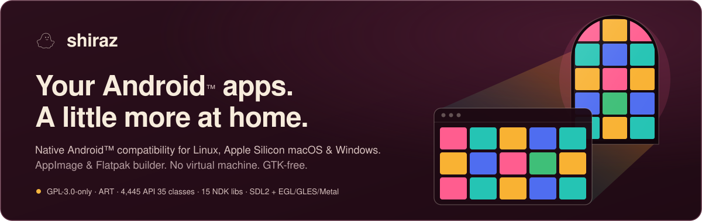

<div align="center">

<a href="https://spectre-oss.github.io/shiraz/">
  
</a>

<br /><br />

<a href="https://github.com/spectre-oss/shiraz/releases"></a>
<a href="LICENSE"></a>
<a href="#status"></a>
<a href="#how-it-works"></a>
<a href="https://github.com/spectre-oss/shiraz/actions/workflows/quality.yml"></a>

<br /><br />

[Try Builder](https://spectre-oss.github.io/shiraz/#builder) · [Compatibility](https://spectre-oss.github.io/shiraz/compatibility/) · [Shiraz Web](docs/WEB.md) · [macOS Launcher](macos/Launcher/README.md) · [Documentation](docs/README.md)

</div>

---

[Shiraz](https://www.openstreetmap.org/node/26082452) is an experimental, open-source compatibility layer that brings Android™ apps to Linux desktops, with an early native port for Apple Silicon macOS and a long-term goal of supporting Linux phones. It runs app bytecode and native libraries directly on the host — without booting an Android system image, running a virtual machine, or depending on GTK.

> [!WARNING]
> **Experimental — no app sandbox.** Shiraz does not provide Android-style app isolation. APKs execute with the privileges of the launching user and can access that user's files and network. **Only run APKs you trust.** When testing unfamiliar APKs, use an isolated environment such as an unprivileged LXC container or a dedicated VM without exposing personal files or sensitive host resources. See [SECURITY.md](SECURITY.md).

## One runtime, four ways to use it

| Interface | What it does | Best for |
| --- | --- | --- |
| **Shiraz Runtime** | The core CLI, ART host, framework layer, and native adapters ([development guide](docs/DEVELOPMENT.md)). | Running APKs on Linux desktops and developing Android compatibility. |
| **[Shiraz Builder](https://spectre-oss.github.io/shiraz/#builder)** | Packages an APK and the runtime into a standalone Linux AppImage directly in your browser — your APK stays local ([guide](docs/BUILDER.md)). | Turning a supported APK into a single-file Linux application. |
| **[Shiraz Web](docs/WEB.md)** | Runs an APK on a Linux host and streams its screen, touch, and keyboard to any browser over WebRTC. | Trying apps through a browser locally or on Linux phones from a host. |
| **[Shiraz Launcher](macos/Launcher/README.md)** *(macOS, exp.)* | Native SwiftUI shelf for Apple Silicon Macs with per-app screen presets, F-Droid catalog browsing, Dock icons, and live console ([watch demo](https://spectre-oss.github.io/shiraz/#mac)). | Managing, configuring, and launching local APKs on Apple Silicon. |

Builder creates a standalone Linux application, Web streams from a Linux host, and Launcher drives local runs on Apple Silicon. All of them share the Shiraz runtime and its compatibility limits.

## How it works

Shiraz executes Android DEX bytecode with a standalone host build of **ART** (Android's runtime) and translates Android framework, resource, and JNI calls into native Linux or macOS functionality using **SDL** and **EGL/GLES**. On Apple Silicon Macs, an in-process guest ELF loader, bionic ABI thunks, and **ANGLE (Metal)** run `arm64-v8a` native libraries directly; on `x86_64` Linux, optional ARM64 translation built on [Digitalis](https://digitalisx64.github.io/) runs supported ARM64 code from source builds.

| Layer | Role | Source |
| --- | --- | --- |
| `01` **Your APK** | Inspects the unmodified package, manifest, resources, and native ABIs. | [`src/shiraz/`](src/shiraz) |
| `02` **ART** | Standalone host build executes DEX bytecode (interpreter and AOT where supported). | [`scripts/bootstrap_runtime.py`](scripts/bootstrap_runtime.py) |
| `03` **Android™ API layer** | All 4,445 Android API 35 `android.*` class surfaces in Java + ART boot jars (bounded per-subsystem behavior). | [`java/android/`](java/android) |
| `04` **Native bridges** | JNI, bionic compatibility, Skia, fonts, audio, SQLite, EGL/GLES, and guest ELF loading. | [`native/`](native) |
| `05` **Desktop host** | Presents windows, input, and lifecycle directly on Linux or macOS. | [`native/presentation.cpp`](native/presentation.cpp) |

## Status

| Platform | State | Current scope & limits |
| --- | --- | --- |
| **Linux** (`x86_64`, `aarch64`) | Experimental · Active | Prebuilt `x86_64` and `aarch64` browser base AppImages, the browser builder, and an `amd64` `shiraz-web` Debian package are published on [GitHub Releases](https://github.com/spectre-oss/shiraz/releases). Selected apps and games work interactively ([tested applications](docs/tested.md), [compatibility tracker](https://spectre-oss.github.io/shiraz/compatibility/)), while behavioral gaps, graphics limits, and unsupported media features remain. |
| **macOS** (Apple Silicon) | Experimental · Early | Native Mach-O ART, ANGLE-Metal GLES/Skia GPU canvas, guest ELF loader, bionic ABI adapters, and SwiftUI [Launcher](macos/Launcher/README.md). Loaded OsmAnd+'s seven native libraries through an OsmAndCore JNI round trip and Telegram's native initialization, but full app compatibility and a supported macOS release remain in progress ([macOS goal & checklist](docs/macos_final_goal.md)). |
| **Linux phones** | Future goal | Long-term target. `aarch64` base AppImages build in CI and Shiraz Web targets mobile touch and keyboard controls, but phone-level compatibility is not yet established. |

- **Framework API coverage:** All 4,445 / 4,445 Android API 35 `android.*` framework class surfaces (49 / 49 areas) are implemented and smoke-tested on OpenJDK and standalone ART; behavioral parity and hardware backends remain bounded per subsystem — see [Framework APIs goal](docs/framework_final_goal.md) and [missing Android libraries](docs/MISSING_ANDROID_LIBRARIES.md).
- **Local verification:** With pinned development dependencies prepared, run `make check` on Linux (includes Linux EGL/JNI checks) or `make macos-guest-check` on Apple Silicon macOS.

## Get started

- **Package an AppImage in your browser:** Open [Shiraz Builder](https://spectre-oss.github.io/shiraz/#builder) — no upload, everything runs locally in WebAssembly ([Builder guide](docs/BUILDER.md)).
- **Run apps through a browser:** Install the `shiraz-web` `.deb` package from [Releases](https://github.com/spectre-oss/shiraz/releases) or run `go-server` from source ([Web setup guide](docs/WEB.md)).
- **Build and run from source:** With runtime dependencies prepared (see [development guide](docs/DEVELOPMENT.md) and [Makefile](Makefile)):

```sh
# Build runtime and run an APK directly on Linux
make build
make run APK=/absolute/path/application.apk

# Or package a standalone Linux AppImage
make appimage APK=/absolute/path/application.apk
```

To verify and fetch an open-source APK from F-Droid using Shiraz's pinned repository check:

```sh
python3 -m shiraz fdroid sync --cache fdroid
python3 -m shiraz fdroid fetch org.example.app --cache fdroid --output app.apk
```

On Apple Silicon macOS, build the native app shelf with `make launcher-app` — see [macOS Launcher](macos/Launcher/README.md) and the [macOS checklist](docs/macos_final_goal.md).

<details>
<summary><strong>Advanced runtime &amp; developer flags</strong></summary>

- **Block direct internet access in a packaged Linux AppImage (`--no-internet`):**

  ```sh
  ./YourApp.AppImage --no-internet
  ```

  Enables a Linux seccomp policy that blocks non-Unix socket creation in Java/native code and child processes, closes inherited sockets, and disables `io_uring`. Launch fails closed if the policy cannot be installed. Local Unix IPC remains available for display and audio; this is not a complete sandbox and does not prevent network access through an external local service. Apps requiring servers may not function offline. Use `--diagnose` to inspect the selected policy without launching.

- **Native-only ABI splits (`--native-split`):**

  ```sh
  PYTHONPATH=src python3 -m shiraz run base.apk --native-split split_config.arm64_v8a.apk
  ```

  Accepts a matching native-only ABI split without modifying the APKs. Package/version mismatches and code or resource splits are rejected. This is not general APKM installation support.

- **Experimental ARM64 translation on `x86_64` Linux (Digitalis):**
  Point to the built bridge via `SHIRAZ_DIGITALIS_LIBRARY=/absolute/path/libberberis_arm64.so`. Build its core with `make runtime-digitalis` and platform proxies with `make digitalis-platform-proxies`. The pinned Digitalis guest-support libraries must be visible under `/system` inside the test process's private namespace (never install them over the host). Run `make digitalis-platform-smoke DIGITALIS_GUEST_SYSTEM=/path/to/guest/system` to check translated math, thread attributes/signals/exit, and the existing NDK media subset. Unsupported media APIs fail explicitly. Digitalis is not yet wired into the AppImage packager.

- **Virtual touch from mouse drags (`SHIRAZ_MOUSE_AS_TOUCH=1`):**
  Exposes a virtual single-touch device and translates left-button mouse drags into Android finger gestures. Physical touch input and host mouse capture remain available; unset it for normal mouse events.

</details>

## Documentation

| Topic | Guide |
| --- | --- |
| Full documentation index | [docs/README.md](docs/README.md) |
| Setup, architecture, builds, and tests | [docs/DEVELOPMENT.md](docs/DEVELOPMENT.md) |
| Observed app results and limits | [docs/tested.md](docs/tested.md) |
| Browser AppImage builder (Go/WASM) | [docs/BUILDER.md](docs/BUILDER.md) |
| WebRTC browser runner | [docs/WEB.md](docs/WEB.md) |
| macOS Launcher (SwiftUI) | [macos/Launcher/README.md](macos/Launcher/README.md) |
| Android API 35 roadmap (4,445 classes) | [docs/framework_final_goal.md](docs/framework_final_goal.md) |
| Native macOS (Apple Silicon) checklist | [docs/macos_final_goal.md](docs/macos_final_goal.md) |
| AI-assisted isolated testing & PRs | [docs/AI_CONTRIBUTING.md](docs/AI_CONTRIBUTING.md) |
| Security model and isolation boundaries | [SECURITY.md](SECURITY.md) |

## Contributing

Bug reports, compatibility fixes, tests, and clearer documentation all help Shiraz grow. Start with the [documentation index](docs/README.md) and [development guide](docs/DEVELOPMENT.md).

If you have access to a capable AI coding assistant — such as GPT 6.1 Sol, Astra, Opus 5.5, or Sonnet 5.5 — we would especially appreciate help reproducing and fixing real app bugs. Start with an app you care about and trust, and follow the [AI-assisted contribution guide](docs/AI_CONTRIBUTING.md) covering isolated execution, evidence collection, issue reports, and pull requests. You do not need an AI assistant to contribute; please review and test any AI-generated changes before submitting.

### Help fund Shiraz

Shiraz is expensive to develop: AI tools, compute, and testing cost real money. We have plenty of ideas and future work planned, but funding is a real limit on how much we can do.

So far, we have received no financial support from OpenAI or Anthropic. All funding comes from us — people who love open source, believe in Linux phones, and want everyone to have the freedom to control their own hardware. If you like Shiraz and believe in that future, please consider donating. Your support helps us keep building. Thank you.

## Acknowledgments

Shiraz is built with the help of AI coding assistants: OpenAI Codex (primarily using GPT Astra and GPT 6.1 Sol) and Grok CLI for general tasks.

## Credits & license

ARM64 support builds on Digitalis and AOSP Berberis. Thanks to [utzcoz](https://github.com/utzcoz), the Digitalis contributors, and the Android Open Source Project — see [LICENSES/DIGITALIS-NOTICE.txt](LICENSES/DIGITALIS-NOTICE.txt).

Shiraz's original code is licensed under [GPL-3.0-only](LICENSE). Third-party code, libraries, and fonts retain their own licenses and copyright notices; Shiraz's license does not replace them. Thanks also to the projects documented in [LICENSES](LICENSES):

| Component | License & notice |
| --- | --- |
| AOSP contributions & ripple rendering adaptations | [Apache-2.0](LICENSES/Apache-2.0.txt) · [AOSP notice](LICENSES/AOSP-NOTICE.txt) · [Ripple notice](LICENSES/RIPPLE-NOTICE.txt) |
| Bionic translation linker (`android_translation_layer`) | Original BSD-style notice · [Bionic linker notice](LICENSES/BIONIC-LINKER.txt) |
| Skia & libsndfile | BSD-3-Clause / LGPL-2.1-or-later · [Skia notice](LICENSES/SKIA-NOTICE.txt) · [sndfile notice](LICENSES/SNDFILE-NOTICE.txt) |
| Noto fonts | SIL Open Font License 1.1 · [Noto fonts notice](LICENSES/NOTO-FONTS.txt) |
| macOS text, path, and image libraries | FreeType (FTL), HarfBuzz / fontconfig / pixman (MIT-style), cairo (LGPL-2.1), libwebp (BSD-3-Clause + patent grant), libjpeg-turbo (IJG, BSD-3-Clause, zlib) · [macOS graphics notice](LICENSES/MACOS-GRAPHICS-NOTICE.txt). *This software is based in part on the work of the Independent JPEG Group.* |
| macOS OpenGL ES & GPU canvas libraries | ANGLE (BSD-3-Clause), Abseil (Apache-2.0), Chromium zlib (Zlib), Chromium zlib/google & anglebase (BSD-3-Clause), xxHash (BSD-2-Clause), Skia with skcms (BSD-3-Clause) · [macOS GPU notice](LICENSES/MACOS-GPU-NOTICE.txt) |

These are acknowledgments, not a complete license inventory for every build. Redistributed components must retain their applicable license texts and notices.

[Android is a trademark of Google LLC.](https://developer.android.com/legal) Other product names and trademarks belong to their respective owners. Shiraz is an independent project; references to other projects or companies do not imply affiliation or endorsement.

---

<div align="center">

<p dir="rtl" lang="fa">
بس بگردید و بگردد روزگار<br />
دل به دنیا در نبندد هوشیار<br />
ای که دستت می‌رسد کاری بکن<br />
پیش از آن کز تو نیاید هیچ کار
</p>

<p><em>Many have passed, and time will turn; / The wise do not bind their hearts to this world. / While you still have the power, do some good, / Before the day you can do nothing more.</em></p>

<p><a href="https://ganjoor.net/saadi/mavaez/ghasides/sh28">سعدی — قصیدهٔ شمارهٔ ۲۸</a> · Saadi</p>

</div>
